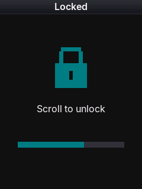
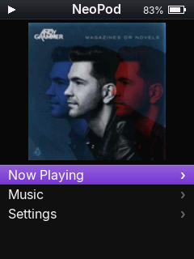
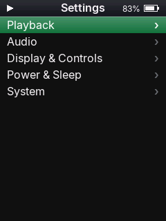
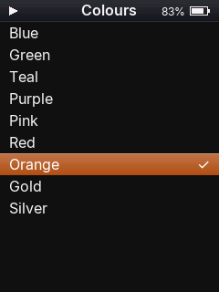
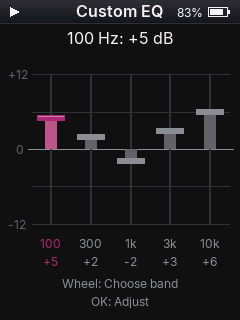

# NeoPod

**NeoPod** is an open-source custom firmware for the **Fosi Audio DAP Neo** digital audio player. It brings a clean, retro iPod-style interface, smooth navigation, album artwork support, and bit-perfect playback powered by a dual-core audio architecture.

## Screenshots

A few screenshots of different menus/pages within NeoPod and a sample of some of the colours you can use! 

| Lock screen · Teal | Home screen · Purple | Cover Flow |
| :---: | :---: | :---: |
|  |  |  |
| **Settings menu · Green** | **Colours menu · Orange** | **Custom EQ · Pink** |
|  |  |  |

---

## 🙏 Credits

NeoPod is a direct hardware port of **[EchoPod](https://github.com/BasilSkyWalk/echopod)** by **BasilSkyWalk** and the EchoPod open-source contributors. 

Huge credit and gratitude go to the original EchoPod developers for creating the user interface, audio engine, theme framework, and core system architecture. NeoPod adapts this foundation specifically for the Fosi Audio DAP Neo's Rockchip SoC, ST7789 portrait display bus, custom GPIO/DAC routing, and key ladder.

---

## ⚠️ Disclaimer

> [!IMPORTANT]
> **Use at your own risk.** The author and contributors of this project are **NOT responsible** for any device damage, data loss, bricked hardware, or hardware failure that may result from installing or using this software.
> 
> This is an independent, community-developed open-source project. The author is **NOT affiliated with, endorsed by, or connected to Fosi Audio in ANY WAY.**

---

## Latest release: v1.6.1

[Download v1.6.1](https://github.com/danielNZ27/NeoPod-Fosi-DAP-Neo-Custom-Firmware/releases/tag/V1.6.1) · [Detailed changelog](https://github.com/danielNZ27/NeoPod-Fosi-DAP-Neo-Custom-Firmware/blob/main/CHANGELOG.md)

Brings high-quality 128x128 album artwork scaling with real-time bilinear interpolation, Floyd-Steinberg error-diffusion dithering, and a clean 5-category Settings menu structure (Playback, Audio, Display & Controls, Power & Sleep, System).

Upgrading from previous versions: update the firmware image (`DP3_V161.IMG`) and the matching `neo_scan.bin` companion in your MicroSD card's `.echo` folder. Preserve existing settings, library, and cover files when merging `.echo`.

## 🎵 Supported Audio Formats & Codecs

NeoPod features hardware-accelerated playback offloaded to the secondary processor core (Core 1):

| Format | File Extension | Specifications & Features | Decoding Engine |
| :--- | :--- | :--- | :--- |
| **FLAC** | `.flac` | Free Lossless Audio Codec (16-bit / 24-bit, up to 192 kHz bit-perfect lossless), Vorbis Comments, embedded artwork | Hardware Core 1 (`neo_flac.bin`) |
| **MP3** | `.mp3` | MPEG Audio Layer III (CBR & VBR up to 320 kbps), ID3v1 / ID3v2.3 / ID3v2.4 tags, embedded artwork | Hardware Core 1 (`neo_mp3.bin`) |
| **AAC-LC** | `.m4a` | AAC-LC in supported MP4/M4A containers | Helix AAC on Core 1 (`neo_aac.bin`) |
| **Opus** | `.opus` | Ogg Opus, native 48 kHz playback, pre-skip handling | libopus on Core 1 (`neo_opus.bin`) |
| **WAV** | `.wav` | Uncompressed Linear PCM (16-bit / 24-bit RIFF/WAVE) | System Core |

### Equalizer and ReplayGain

- Five EQ bands: 100 Hz, 300 Hz, 1 kHz, 3 kHz and 10 kHz; -12 to +12 dB.
- Built-in presets and up to eight named user presets.
- Custom EQ: turn the wheel to choose a band, press OK to adjust, turn to change gain, then press OK to confirm/save. Selection wraps through all five bands.
- ReplayGain Off, Track and Album modes, with peak-based anti-clipping when peak tags are available.
- EQ and ReplayGain are audio processing; sample-exact output applies when processing is neutral.

### Artwork & Metadata Support
- **Embedded Artwork:** Automatically extracts embedded JPEG and PNG front album covers from FLAC and MP3 files.
- **Folder Artwork:** Reads external image files in the album folder (e.g. `cover.jpg`, `folder.jpg`, `cover.png`).
- **Music Library Tagging:** Fast library scanning and cataloging by Artist, Album, Track, and Title handled by the background indexer (`neo_scan.bin`).

---

## 🚀 Installation Guide (First Time from Stock Firmware)

Follow these steps if your DAP Neo is currently running the factory stock firmware:

### 1. Download Release Files
From the [`release/`](./release/) folder in this repository, obtain:
- `DP3_V161.IMG` (The NeoPod firmware image)
- The `sd-card/.echo` folder (containing `neo_flac.bin`, `neo_mp3.bin`, `neo_aac.bin`, `neo_opus.bin`, and `neo_scan.bin`)

### 2. Copy Files to the DAP Neo
1. Power on your DAP Neo normally and connect it to your PC using a USB-C cable.
2. Two drives will mount on your computer:
   - The **Internal Storage** drive
   - The **MicroSD Card** drive
3. Copy **`DP3_V161.IMG`** directly to the **root** of the **Internal Storage** drive (`/`).
4. Copy the entire **`.echo`** folder directly to the **root** of your **MicroSD Card** (`/`).
   *(The `.echo` folder must be in the root directory so the path is `[SD Card]:\.echo\neo_*.bin`)*.

### 3. Apply the Firmware
1. Safely eject and unplug the USB-C cable from the DAP Neo.
2. The player's stock bootloader will detect `DP3_V161.IMG` and begin the flashing process.
3. Once completed, the player will automatically reboot directly into **NeoPod**! (May not auto reboot. In this instance use a paperclip or pinhead to press the button next to the USB C port. just press it once, don't need to hold, then can power DAP Neo on)

---

## 🔄 Updating NeoPod (Direct Flashing)

Updating to a newer version of NeoPod is fast and does **NOT** require reverting to factory stock firmware:

### 1. Download the New Release
- Download the new `DP3_Vxxx.IMG` file (from [`release/`](./release/)).
- Update any matching companion decoders in `[MicroSD Card]:\.echo\` if the release includes newer companion files.

### 2. Flash Directly via Rockusb Mode
1. Unplug the USB cable and ensure the DAP Neo is turned off (hold **Power** for 3–5 seconds until screen turns off).
2. Press and hold **VOL +**, **VOL -**, and **Center / OK** simultaneously (do **not** touch Power).
3. While continuing to hold those 3 buttons, plug the USB-C cable into your PC. Keep holding for 3–5 seconds, then release. The screen remains black in recovery mode.
4. Run the flashing script:
   ```cmd
   python flash-neo.py release/DP3_V161.IMG
   ```
5. The script flashes both firmware slots, verifies the Slot 1 header, requests a reset and checks whether the live recovery interface disconnects. If normal reset leaves it in recovery, it tries Rockchip's normal-boot/MSC reset mode. If restart cannot be confirmed, it tells you to use the pinhole reset; another flash is not needed.

---

## 🎮 Controls & Navigation

| Control | Action |
| :--- | :--- |
| **Scroll Wheel** | Scroll through menus and lists; choose/adjust Custom EQ bands |
| **Vol+ / Vol-** | Adjust playback volume |
| **Center / OK (Single Press)** | Select / Play / Enter menu |
| **Center / OK (Double Tap)** | Back / Return to previous screen |
| **Power Button (Short Press)** | Screen sleep / wake |
| **Power Button (Long Hold)** | Power off (Goodbye screen) |

---

## 🛠️ Companion Files (`.echo` on MicroSD)

NeoPod utilizes the DAP Neo's secondary CPU core (Core 1) for real-time audio decoding and background database indexing:
- `neo_flac.bin`: Dedicated hardware FLAC audio decoder for Core 1.
- `neo_mp3.bin`: Dedicated hardware MP3 audio decoder for Core 1.
- `neo_aac.bin`: AAC-LC decoder for Core 1.
- `neo_opus.bin`: Ogg Opus decoder for Core 1.
- `neo_scan.bin`: Ultra-fast library rescan and metadata engine.

*Always keep the `.echo` directory on your MicroSD card updated with the files matching your firmware release.*

---

## 💻 Building from Source

### Requirements
- **CMake** 3.20+
- **Ninja** build system
- **ARM GNU Toolchain** (`arm-none-eabi-gcc`)
- **Python** 3.8+

### Build Script
To compile NeoPod and package the firmware image automatically:
```powershell
./build-neopod.ps1
```
The compiled firmware image and companion binaries will be generated in `build/echopod-neo/`.

---

## 📄 License

NeoPod is licensed under the **GNU General Public License v3.0** (GPL-3.0), inheriting the open-source license of the upstream EchoPod project. See [LICENSE](./LICENSE) for details.
