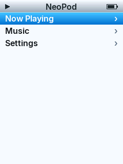
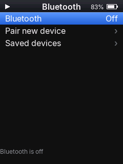

# NeoPod

[](https://github.com/danielNZ27/NeoPod-Fosi-DAP-Neo-Custom-Firmware/releases)
[](LICENSE)

**NeoPod** is an open-source custom firmware for the **Fosi Audio DAP Neo** digital audio player. It brings a clean, retro iPod-style interface, smooth navigation, album artwork support, Bluetooth audio with saved devices and automatic reconnect, and bit-perfect wired playback powered by a dual-core audio architecture.

---

> [!CAUTION]
> **Use at your own risk.** Installing custom firmware carries inherent risks. The authors and contributors are not responsible for bricked devices, lost data, or hardware damage. This is an independent community project and is **not affiliated with or endorsed by Fosi Audio**.

---

## ✨ Features

- **Retro UI & Theming**: Classic iPod navigation layout, customizable accent colors (Teal, Purple, Green, Orange, Magenta), smooth Cover Flow view, and an authentic iPod Classic theme.
- **Dual-Core Audio Engine**: Bit-perfect wired decoding offloaded to CPU Core 1 for pop-free, hardware-accelerated playback.
- **Comprehensive Codec Support**: Native playback for FLAC (up to 24-bit / 192 kHz), MP3, AAC-LC, Ogg Opus, and uncompressed WAV.
- **Smart Bluetooth Stack**: Low-latency pairing, automatic reconnection, and storage for up to 6 saved devices with seamless PCM anti-pop transitions.
- **Advanced Sound Tuning**: 5-band custom EQ (-12 dB to +12 dB) with user presets, plus ReplayGain track/album modes with anti-clipping protection.
- **Fast Media Indexing**: Embedded ID3/Vorbis cover extraction and directory-level artwork scanning (`cover.jpg`, `folder.jpg`).

---

## 📸 Interface Preview

| Lock Screen | Home (Custom Accent) | Cover Flow |
| :---: | :---: | :---: |
|  |  |  |

| Custom EQ | iPod Classic Theme | Bluetooth Manager |
| :---: | :---: | :---: |
|  |  |  |

---

## 📥 Installation

### Method 1: First-Time Install (From Stock Firmware)

1. Download **`DP3_V170.IMG`** and the **`sd-card/.echo/`** companion folder from the [Latest Release](https://github.com/danielNZ27/NeoPod-Fosi-DAP-Neo-Custom-Firmware/releases/latest).
2. Connect your DAP Neo to your computer via USB-C and power it on.
3. Place **`DP3_V170.IMG`** directly in the root directory of the player's **Internal Storage**.
4. Copy the entire **`.echo`** directory to the root directory of your **MicroSD Card** (resulting in `[SD Card]:/.echo/neo_*.bin`).
5. Safely unmount and disconnect the USB cable.
6. The stock bootloader will automatically detect the image and flash NeoPod.
   > *Note: If the player does not reboot automatically after flashing, press the hardware reset pinhole next to the USB-C port once.*

---

### Method 2: Updating an Existing NeoPod Install (Direct Flashing)

You can flash new firmware images directly using the Rockchip bootloader interface without reverting to stock:

1. Power off the device (hold **Power** for 5 seconds).
2. Hold **VOL +**, **VOL -**, and **Center / OK** simultaneously (leave **Power** untouched).
3. Connect the USB-C cable to your PC while holding the three buttons; release after 3–5 seconds. The screen will remain black in Rockusb recovery mode.
4. Flash the update image:
   ```bash
   python flash-neo.py release/DP3_V170.IMG
   ```
5. Update any companion decoders in `[SD Card]:/.echo/` if specified in the [Release Notes](CHANGELOG.md).

---

## 🎛️ Navigation & Controls

| Control | Function |
| :--- | :--- |
| **Scroll Wheel** | Navigate menus, scroll lists, and adjust EQ sliders |
| **Center / OK (Single Press)** | Confirm / Select / Play / Pause |
| **Center / OK (Double Press)** | Back / Return to parent screen |
| **VOL+ / VOL-** | Master volume control |
| **Power (Short Press)** | Screen wake / sleep |
| **Power (Long Press)** | System power off |

---

## 🎧 Audio Engine & Supported Formats

Decoding is handled across the Rockchip SoC to maximize battery efficiency and eliminate audio dropouts:

| Codec | Extensions | Specifications | Execution Core |
| :--- | :--- | :--- | :--- |
| **FLAC** | `.flac` | 16/24-bit up to 192 kHz, Vorbis comments, embedded art | Core 1 (`neo_flac.bin`) |
| **MP3** | `.mp3` | CBR & VBR up to 320 kbps, ID3v1/v2 tags, embedded art | Core 1 (`neo_mp3.bin`) |
| **AAC** | `.m4a` | AAC-LC containerized streams (Helix AAC) | Core 1 (`neo_aac.bin`) |
| **Opus** | `.opus` | Ogg Opus 48 kHz native playback | Core 1 (`neo_opus.bin`) |
| **WAV** | `.wav` | Linear PCM (16/24-bit RIFF/WAVE) | Core 0 (System Core) |

### MicroSD Companion Binaries (`.echo/`)
Ensure the following files remain in the root `.echo/` directory on your MicroSD card:
- `neo_flac.bin` / `neo_mp3.bin` / `neo_aac.bin` / `neo_opus.bin`: Secondary core audio decoders.
- `neo_scan.bin`: Background tag indexer and metadata parser.
- `boot.rgb565`: Custom boot animation asset.

---

## 🛠️ Building from Source

### Prerequisites
- CMake 3.20+
- Ninja build system
- ARM GNU Embedded Toolchain (`arm-none-eabi-gcc`)
- Python 3.8+

### Compile
Run the build script to compile binaries and package the firmware image:

```powershell
./build-neopod.ps1
```

Compiled images will be written to `release/`, and companion binaries will be staged in `release/sd-card/.echo/`.

---

## 🙏 Credits & Acknowledgments

NeoPod is an adapted hardware port of **[EchoPod](https://github.com/BasilSkyWalk/echopod)** by **BasilSkyWalk** and the EchoPod open-source community. Gratitude goes to the upstream team for the core interface, theme engine, and audio routing architecture. 

NeoPod adapts this system for the Fosi Audio DAP Neo's Rockchip platform, ST7789 portrait display interface, custom GPIO routing, and resistor key ladder.

---

## 📄 License

This project is licensed under the [GNU General Public License v3.0](LICENSE) in accordance with the upstream EchoPod project.
